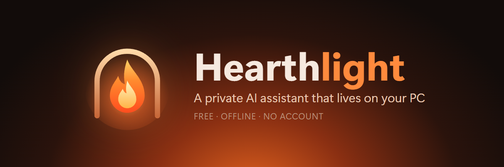
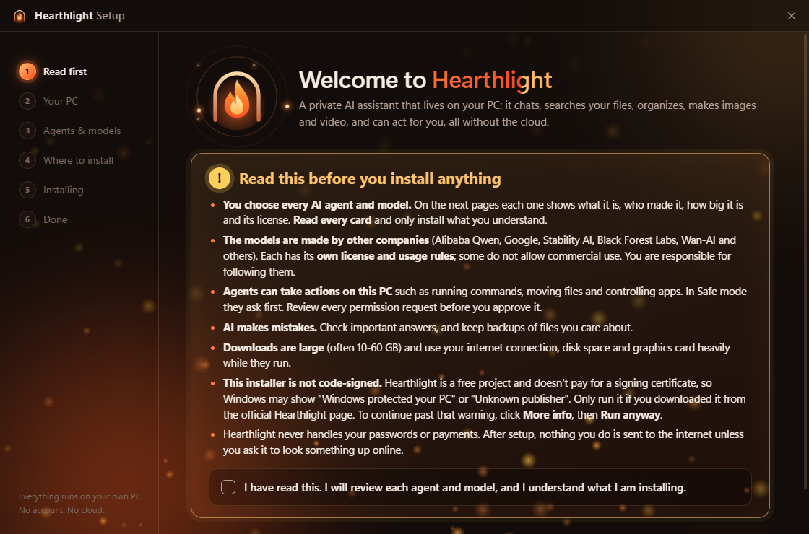
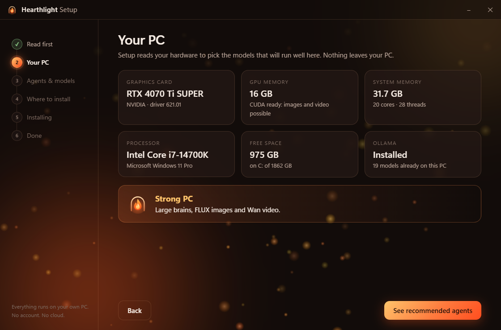
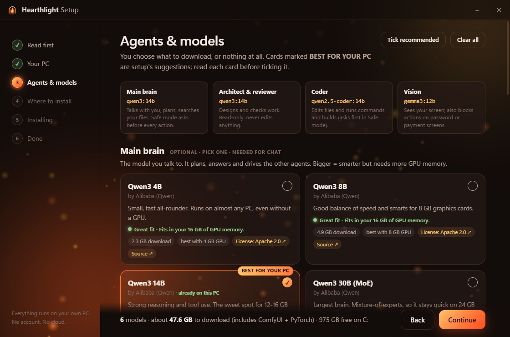
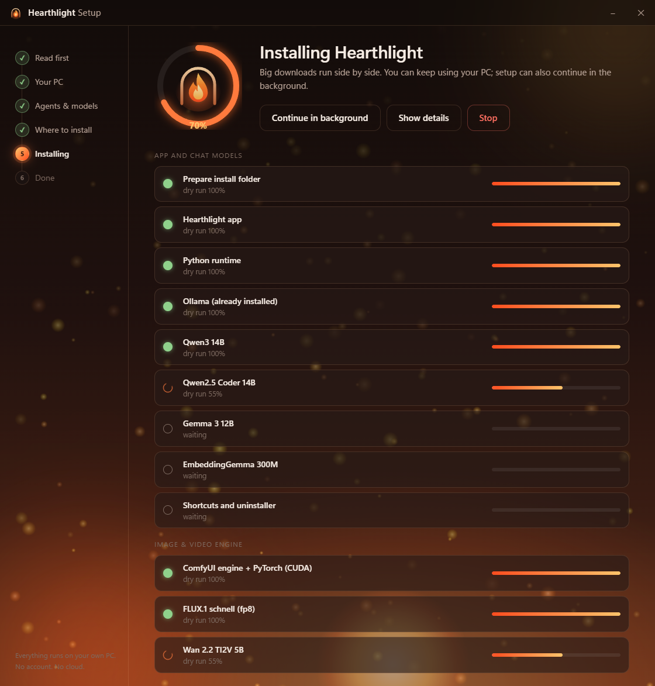

# Hearthlight

**[⬇ Download HearthlightSetup.exe](https://github.com/Gamer4life36/hearthlight-releases/releases/latest)** (Windows 10/11, 64-bit)

A private AI assistant that lives on your PC. It chats, searches and organizes your files, checks your PC's health, converts media, records your calls and writes the notes, makes images and video on your own graphics card, and can act for you. Everything runs offline. There's no account and no cloud.

**Free, with donations welcome:** https://paypal.me/gamer4life33

## What it does
- **Chat with an assistant you name yourself.** It plans, answers, searches your files and remembers what you teach it.
- **Real skills:**
  - **PC health:** CPU, RAM, drives and GPU, plus your biggest files. It can clean temp files after a dry run first.
  - **File organizer:** sort files by type or month, with an undo. It also finds duplicates.
  - **Media tools:** convert, trim, resize and make GIFs (ffmpeg). It never overwrites your files.
  - **Images and video:** generated on your own GPU (FLUX, Wan 2.2) through a private ComfyUI.
  - **Windows control.**
  - **Meeting notes (new):** record anything that uses your mic, including Zoom, Discord, Teams and games. Ctrl+Alt+R starts and stops it, even inside a game, and it only records when you say so. You get an offline transcript, notes and action items, with templates for meetings, interviews, lectures, game sessions and D&D. You can also import audio or video files, and export to Markdown, txt, HTML, Word or PDF.
- **Safe mode** asks before every action. **Advanced mode** lets a team of specialist agents work together: architect, coder, reviewer, researcher and vision.
- **Word filters (new):** swear words (amber) and slurs (red) are blacked out in the chat and in exports, each with its own toggle. Words with an innocent meaning are judged by the rest of the sentence.
- The assistant never handles your passwords or payments.

## What setup does
- **It scans your PC** (graphics card, memory, disk) and marks the models that fit best. Nothing is ticked for you: you choose every model, or none.
- **Every model card shows** who made it, its size, how well it will run on your PC, and its license.
- **Everything goes into one folder** (C:\Hearthlight by default): the app, a private Python, Ollama if you don't already have it, and the optional image and video engine.
- **No admin rights needed.** It installs just for you, and big downloads resume if they're interrupted.
- **Removing it:** uninstall from Settings › Apps, and it removes everything it added.

## Requirements
- Windows 10 or 11, 64-bit.
- **Chat:** 8 GB RAM minimum. 16 GB or more and a graphics card make it much faster.
- **Images and video:** an NVIDIA graphics card. 6 GB or more of video memory is recommended.
- **Meeting notes:** works on the CPU. An NVIDIA graphics card with 4 GB or more of video memory makes it much faster. Written notes also need a chat model.
- **Disk space:** about 5-60 GB, depending on which models you pick.

## Please read before installing
- **The installer is not code-signed.** Hearthlight is free and doesn't pay for a signing certificate, so Windows may show "Windows protected your PC" / "Unknown publisher". Click **More info**, then **Run anyway**. Only run a copy downloaded from [these releases](https://github.com/Gamer4life36/hearthlight-releases/releases) or the official itch.io page. Each release lists the SHA-256 of the exe so you can check your copy.
- **The AI models are made by other companies** (Alibaba Qwen, Google, Black Forest Labs, Wan-AI and others), and each has its own license. Some do not allow commercial use. Setup links every license before you install.
- **Recording calls:** tell people on the call that you're recording. In many places that's the law. Recordings and notes stay on your PC.
- **AI makes mistakes.** Check important answers, and keep backups of files you care about.

## Feedback, bugs and feature requests
[Open an issue](https://github.com/Gamer4life36/hearthlight-releases/issues/new/choose): bug report, feature request or general feedback.

Hearthlight's own code is under the MIT License. It is free to use, with no warranty.

## Screenshots
| | |
|---|---|
|  |  |
|  |  |

This repository holds only the releases and the issue tracker; the source code is private.
